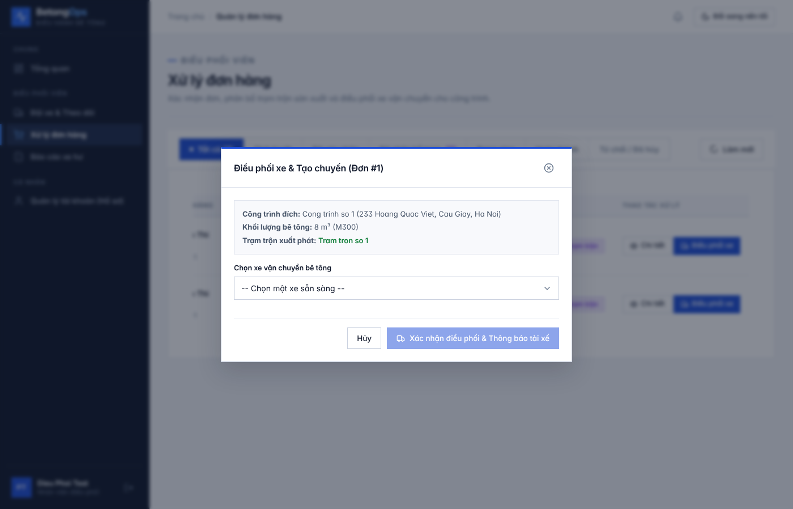
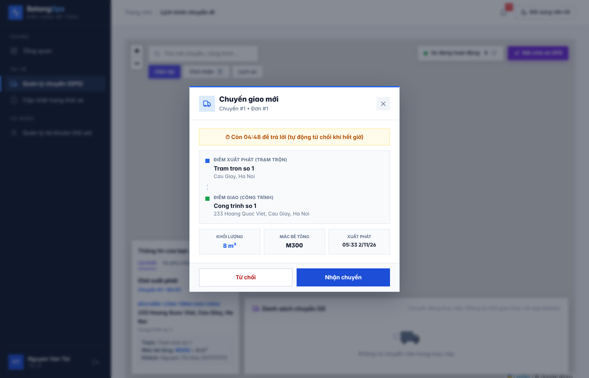
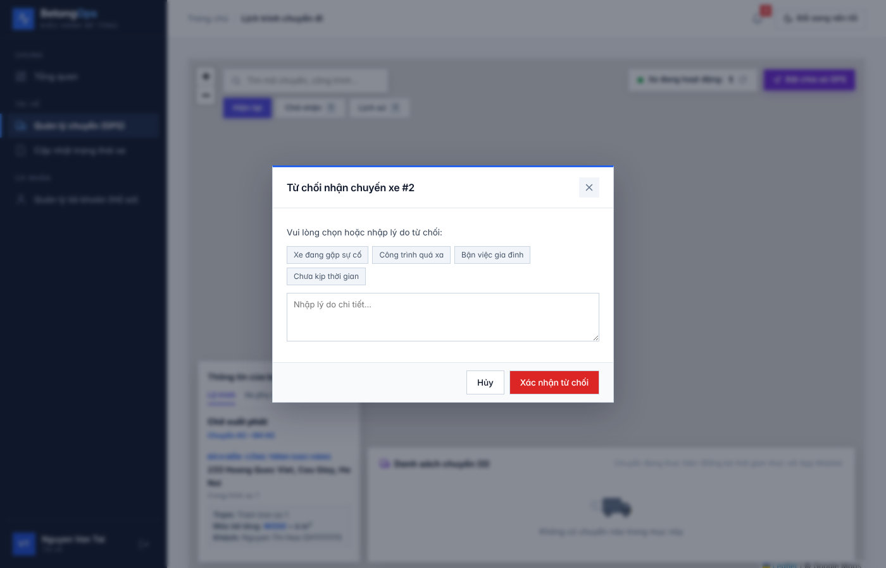
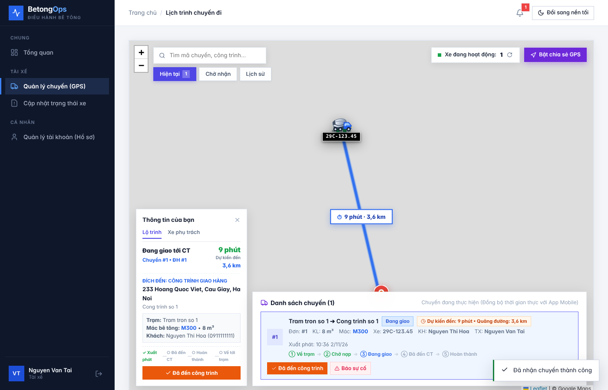
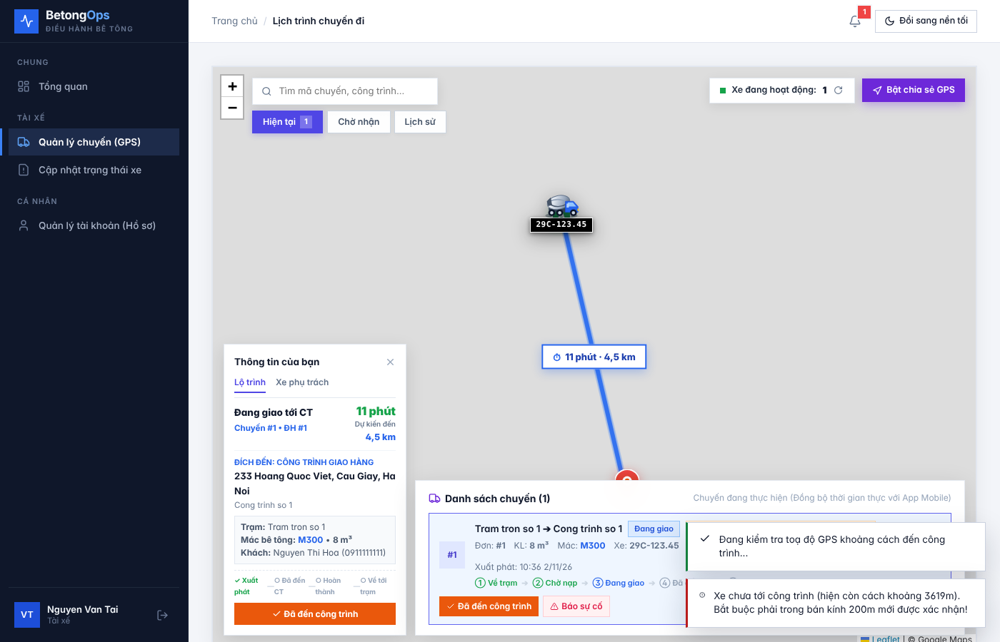
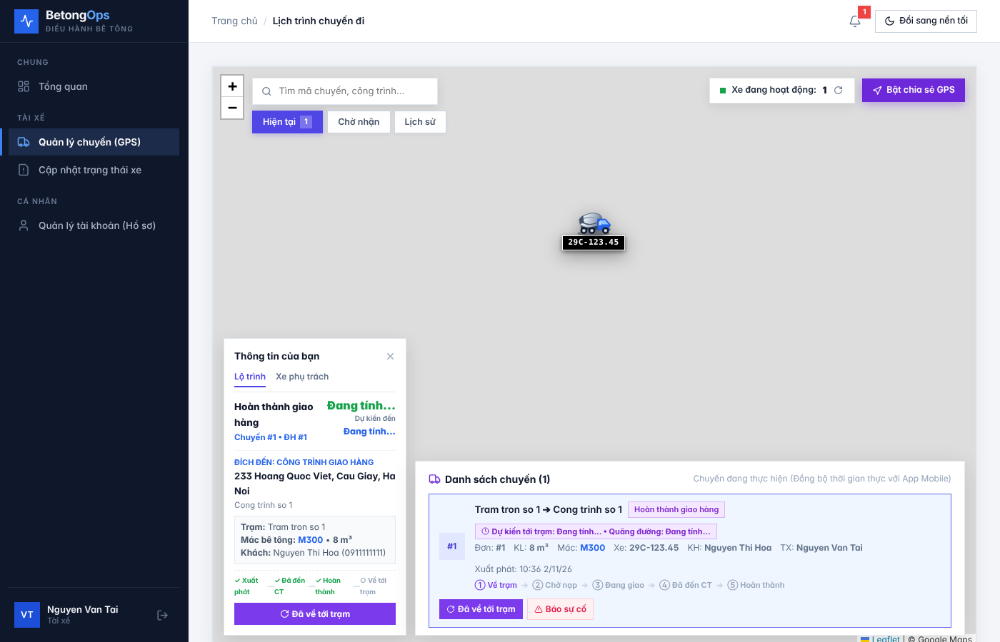
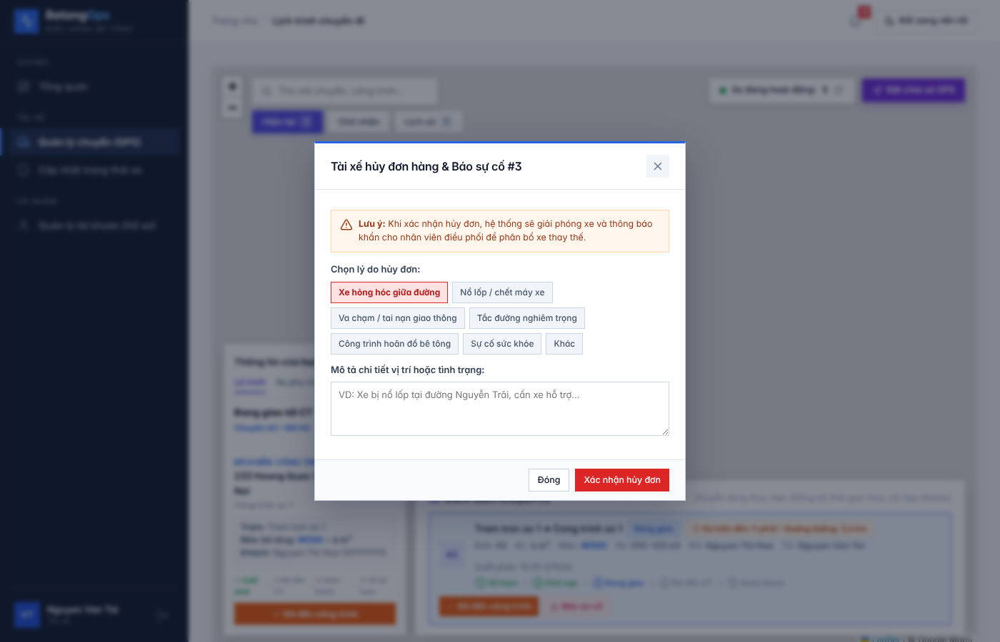
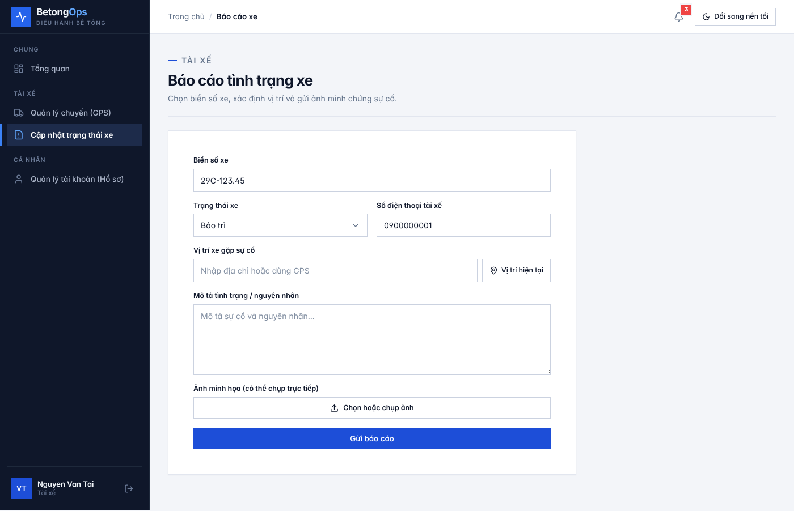

# Hướng dẫn test App và Web – tác nhân Tài xế (bản betong-main_3)

Tài liệu gồm 4 phần:

- **Phần A – Chuẩn bị (làm 1 lần):** bật database, Redis, backend, web, app.
- **Phần B – Test trên Web:** tài xế dùng web, điều phối tạo chuyến trên web. Mình đã chạy thử toàn bộ phần này, ảnh trong thư mục `anh/` là ảnh chụp thật.
- **Phần C – Test trên App Android (máy ảo).**
- **Phần D – Kiểm tra trong database và ghi kết quả.**

Tài khoản test (mật khẩu đều là `123456789`):

| Tài khoản | Vai trò | Dùng để |
|---|---|---|
| `dieuphoi01` | Nhân viên điều phối | Tạo chuyến cho tài xế (chỉ có trên web) |
| `taixe01` | Tài xế, xe 29C-123.45 | Test chính |
| `taixe02` | Tài xế, xe 29C-678.90 | Test "chuyến của tài xế khác" |

Tọa độ dùng khi giả lập vị trí:

| Vị trí | Vĩ độ | Kinh độ |
|---|---|---|
| Trạm trộn (cách công trình ~3,6 km) | 21.0362 | 105.7906 |
| Sát công trình (trong 200 m) | 21.0046 | 105.7984 |

---

## Phần A – Chuẩn bị

Mở **4 cửa sổ CMD** riêng, mỗi cửa sổ chạy một thứ và **để nguyên, không tắt**.

**A1. Redis** – mở file `redis-server.exe` (bản Windows đã tải lần trước). Thấy chữ `Ready to accept connections` là được.

**A2. Backend** (CMD số 1):
```
cd "C:\Users\LENOVO\Downloads\betong-main (3)\betong-main\backend"
mvnw spring-boot:run -Dspring-boot.run.arguments="--spring.datasource.username=hung --spring.datasource.password="
```
Đợi dòng `Started BetongApplication`.
> Vì sao phải ghi dài như vậy: bản 3 đặt mật khẩu MySQL mặc định là `hung2005` (máy trưởng nhóm), còn MySQL của bạn là `hung` với mật khẩu trống. Nếu chưa chép `pom.xml` đã sửa Lombok thì thêm `-Dlombok.version=1.18.42` vào lệnh.

**A3. Dữ liệu test** – mở **MySQL 8.0 Command Line Client**, nhập mật khẩu, rồi chạy:
```
source C:/Users/LENOVO/Downloads/Be tong/betong-test/du_lieu_test_ban_moi.sql
```
Mỗi lần chạy lại file này sẽ có thêm **2 đơn hàng mới** ở trạng thái "Đã phân bổ trạm trộn". Hết đơn để tạo chuyến thì chạy lại.

**A4. Web** (CMD số 2):
```
cd "C:\Users\LENOVO\Downloads\betong-main (3)\betong-main\frontend-web"
npm install
npm run dev
```
`npm install` chỉ cần chạy lần đầu. Mở trình duyệt Chrome vào **http://localhost:5173**.

**A5. App** – mở thư mục `betong-main (3)\betong-main\mobile-app` bằng Android Studio:
1. **Device Manager** → tạo máy ảo nếu chưa có (nên chọn Pixel, **API 34, Google Play**).
2. Bấm ▶ **Run 'app'**. App mặc định gọi máy chủ `http://10.0.2.2:8080/`, tức là backend trên máy tính của bạn.
3. Nếu app báo không kết nối: ở màn đăng nhập bấm **"⚙️ Cấu hình địa chỉ máy chủ"** → **Mặc định**.

---

## Phần B – Test trên Web

### B0. Mở 2 cửa sổ trình duyệt
Web lưu phiên đăng nhập theo trình duyệt, nên cần 2 cửa sổ để đăng nhập 2 người cùng lúc:
- **Cửa sổ thường:** đăng nhập `dieuphoi01`.
- **Cửa sổ ẩn danh** (Chrome: **Ctrl + Shift + N**): đăng nhập `taixe01`.

Cả hai vào http://localhost:5173 → nhập tài khoản → **Đăng nhập**.

### B1. Giả lập vị trí GPS trên Chrome (bắt buộc cho bước "Đã đến")
Máy tính của bạn không ở công trình, nên phải "giả" vị trí cho cửa sổ tài xế:
1. Ở cửa sổ ẩn danh (tài xế), bấm **F12** để mở DevTools.
2. Bấm **⋮** (góc phải DevTools) → **More tools** → **Sensors**.
3. Ở mục **Location** chọn **Other…**, nhập **Latitude** và **Longitude** theo bảng tọa độ ở đầu tài liệu.
4. **Giữ DevTools mở** trong suốt lúc test. Khi trình duyệt hỏi quyền vị trí, chọn **Allow**.

### B2. Điều phối tạo chuyến (cửa sổ `dieuphoi01`)
1. Menu **Xử lý đơn hàng** → tab **Đã phân bổ trạm**.
2. Ở một đơn, bấm **Điều phối xe**.
3. Chọn xe **BKS: 29C-123.45 … Tài xế: Nguyen Van Tai** → bấm **Xác nhận điều phối & Thông báo tài xế**.
4. Kết quả mong đợi: hiện thông báo *"Đã tạo chuyến xe thành công và gửi thông báo nhận chuyến tới tài xế!"*.



### B3. Các ca test phía Tài xế trên web (cửa sổ `taixe01` → menu **Quản lý chuyến (GPS)**)

Các câu trong ngoặc kép ở bước 1–9, 11, 12 và chữ trên nút ở bước 10 là nguyên văn lúc mình chạy thử; bước 13 là kết quả theo thiết kế.

| Bước | Thao tác | Kết quả mong đợi | Ảnh |
|---|---|---|---|
| 1 | Sau khi điều phối tạo chuyến, mở/tải lại trang | Hộp thoại **"Chuyến giao mới"** với dòng đếm ngược *"Còn mm:ss để trả lời (tự động từ chối khi hết giờ)"*, điểm xuất phát, điểm giao, khối lượng, mác bê tông, 2 nút **Từ chối** / **Nhận chuyến** | 02 |
| 2 | Bấm **Từ chối** → chọn **Bận việc gia đình** → **Xác nhận từ chối** | Thông báo *"Đã từ chối chuyến"* | 03 |
| 3 | Điều phối tạo chuyến lại → tài xế bấm **Nhận chuyến** | *"Đã nhận chuyến thành công"*. Chuyến hiện ở tab **Hiện tại**, trạng thái **Đang giao**, có các bước Xuất phát → Đã đến CT → Hoàn thành → Về tới trạm | 04 |
| 4 | Sensors đặt vị trí **trạm trộn** (21.0362, 105.7906) → bấm **Đã đến công trình** | *"Xe chưa tới công trình (hiện còn cách khoảng 3619m). Bắt buộc phải trong bán kính 200m mới được xác nhận!"* | 05 |
| 5 | Sensors đổi sang **sát công trình** (21.0046, 105.7984) → bấm lại **Đã đến công trình** | *"Đã xác nhận xe đã đến công trình!"*. Nút đổi thành **Hoàn thành** | |
| 6 | Bấm **Hoàn thành** | *"Đã xác nhận hoàn thành giao hàng chuyến #…! Khi xe về tới trạm, hãy bấm "Đã về tới trạm"."*. Nút đổi thành **Đã về tới trạm** | 06 |
| 7 | Bấm **Đã về tới trạm** | *"Xe đã về tới Tram tron so 1 (Cau Giay, Ha Noi)! Đã cập nhật vị trí về địa chỉ trạm trộn."*. Chuyến chuyển sang tab **Lịch sử** | |
| 8 | Điều phối tạo chuyến mới → nhận → bấm **Báo sự cố** | Hộp thoại *"Tài xế hủy đơn hàng & Báo sự cố"* với các lý do (Xe hỏng hóc giữa đường, Nổ lốp / chết máy xe, …), ô mô tả, nút **Đóng** / **Xác nhận hủy đơn** | 07 |
| 9 | Chọn **Nổ lốp / chết máy xe**, ghi mô tả → **Xác nhận hủy đơn** | *"Đã hủy chuyến và báo cáo sự cố thành công. Điều phối viên sẽ phân bổ xe khác thay thế."* | |
| 10 | Bấm **Bật chia sẻ GPS** khi đang có chuyến | Nút đổi thành **Đang phát GPS Realtime**. Bên điều phối mở **Đội xe & Theo dõi** để xem xe trên bản đồ | |
| 11 | Menu **Cập nhật trạng thái xe** | Form *"Báo cáo tình trạng xe"*: biển số và SĐT tự điền; chọn **Đang hoạt động / Bảo trì**; vị trí; mô tả; ảnh; nút **Gửi báo cáo** | 08 |
| 12 | Ở form trên, để trống vị trí rồi bấm **Gửi báo cáo** | Báo *"Vui lòng nhập hoặc định vị vị trí xe gặp sự cố"* | |
| 13 | Điều phối tạo chuyến, tài xế **không bấm gì** trong 5 phút | Hết giờ đếm ngược, chuyến tự chuyển **Đã từ chối**, điều phối nhận thông báo | |

> **Mẹo:** nếu bấm "Đã đến công trình" mà báo *"Không xác định được vị trí GPS hiện tại của bạn…"*, hãy kiểm tra DevTools còn mở và Sensors đang đặt vị trí. Nếu đang **Bật chia sẻ GPS** thì thử tắt đi rồi bấm lại.
>
> **Lưu ý về xe sau khi báo sự cố:** xe chuyển sang **Bảo trì**. Muốn test tiếp với xe này thì vào **Cập nhật trạng thái xe**, chọn **Đang hoạt động**, điền đủ thông tin rồi gửi (hoặc dùng app ở Phần C).

| Ảnh minh họa | |
|---|---|
|  |  |
|  |  |
|  |  |
|  | |

---

## Phần C – Test trên App Android (máy ảo)

### C1. Đặt vị trí cho máy ảo
Trên thanh bên phải máy ảo bấm **⋯ (Extended controls)** → **Location** → **Single points**. Nhập **Latitude / Longitude** theo bảng tọa độ ở đầu tài liệu → bấm **Set location**.

### C2. Làm theo thứ tự này (khoảng 20 phút; mỗi bước nên chụp màn hình)

| # | Mã ca | Thao tác | Kết quả mong đợi |
|---|---|---|---|
| 1 | DN-01 | Settings → Apps → app → Storage → **Clear data**, mở lại app | Màn "Bê Tông Driver": ô *Tên đăng nhập / SĐT / Email*, ô *Mật khẩu*, nút **Đăng nhập** |
| 2 | DN-03 | Để trống, bấm **Đăng nhập**; rồi nhập `taixe01` + `1234567` | Chữ đỏ *"Vui lòng nhập tên đăng nhập"*, *"Vui lòng nhập mật khẩu"*; với 7 ký tự: *"Mật khẩu phải từ 8 ký tự trở lên"* |
| 3 | DN-05 | Đăng nhập `dieuphoi01` | *"Ứng dụng này chỉ dành cho tài khoản Tài xế"* |
| 4 | DN-02 | Đăng nhập `taixe01` | Vào trang chủ |
| 5 | GPS-02 | Mở Lịch trình, khi hỏi quyền vị trí chọn **Don't allow** | *"Chưa cấp quyền vị trí"* |
| 6 | GPS-01 | Settings → Apps → app → Permissions → Location → **Allow**, mở lại Lịch trình | Hiện tọa độ và *"GPS ±x m"* |
| 7 | QLC-10 | Chưa có chuyến | *"Chưa có chuyến được giao"* |
| 8 | GPS-03 | Kéo thanh trạng thái, tắt **Location**, mở lại Lịch trình (xong bật lại) | *"Hãy bật định vị (GPS) trên điện thoại"* |
| 9 | QLC-01 | Trên web, `dieuphoi01` tạo chuyến cho xe 29C-123.45 | App đổ chuông, rung, hộp thoại đề nghị chuyến có đếm ngược *"Còn mm:ss để trả lời"* |
| 10 | QLC-05 | Bấm **Từ chối** → ở danh sách lý do bấm **Quay lại** | Hộp thoại đề nghị chuyến vẫn còn |
| 11 | QLC-02, QLC-09 | Bấm **Nhận chuyến** | Bản đồ lộ trình trạm → công trình, thông tin chuyến, trạng thái *Đang giao* |
| 12 | QLC-12 | Bấm nút gọi | Mở trình gọi với số `0911111111` |
| 13 | GPS-06 | Bấm **Home**, đổi vị trí máy ảo | Thanh thông báo *"Đang thực hiện chuyến giao bê tông – Đang chia sẻ vị trí xe theo thời gian thực"* |
| 14 | GPS-07 | Đặt vị trí **21.0046, 105.7984** | *"Bạn đã tới gần công trình (trong phạm vi 200m) — bấm "Đã đến công trình" để xác nhận"* |
| 15 | CNTT-04 | Bấm **Đã đến công trình** → chọn **Chưa** | Không đổi trạng thái; bấm lại → **Xác nhận** để đi tiếp |
| 16 | GPS-08, CNTT-05 | Bấm **Hoàn thành** → **Hoàn thành** | *"Đã hoàn thành giao hàng! Hãy bấm 'Đã về tới trạm'…"*; thông báo định vị biến mất. **Ghi lại tiêu đề màn hình lúc này** |
| 17 | CNTT-06 | Bấm **Đã về tới trạm** → xác nhận | Hộp thoại *"Đã hoàn thành chuyến"* |
| 18 | CNTT-08 | Điều phối tạo chuyến mới → **Nhận** → mở **Báo cáo sự cố** → **Đóng** | Không tạo sự cố |
| 19 | CNTT-15 | Mở màn báo hỏng xe, **xoá trống** biển số, bấm Gửi | *"Vui lòng nhập biển số xe"*, *"Vui lòng mô tả sự cố"*, *"Vui lòng chọn ảnh minh chứng"* (**không** gửi thật) |
| 20 | CNTT-16 | Nhập vài chữ → bấm quay lại | *"Thoát báo cáo?"* → **Ở lại** giữ dữ liệu |
| 21 | QLC-13 | Ở CMD backend bấm **Ctrl + C**, mở Lịch trình | *"Không kết nối được máy chủ. Kiểm tra mạng và thử lại"*, app không văng |

---

## Phần D – Kiểm tra trong database và ghi kết quả

Trong DBeaver (hoặc MySQL Command Line, sau lệnh `USE quanly_betong;`) có thể xem trực tiếp:
```sql
-- Trạng thái chuyến: 5 Chờ xác nhận, 3 Đang giao, 2 Đã đến, 8 Hoàn thành giao hàng, 4 Hoàn thành, 6 Từ chối, 7 Sự cố
SELECT id_chuyen, trang_thai, ly_do_tu_choi, thoi_gian_phan_cong FROM chuyen ORDER BY id_chuyen DESC;
-- Trạng thái xe: 1 Sẵn sàng, 2 Đang giao hàng, 0 Bảo trì
SELECT id_xe, bien_so, trang_thai FROM xe;
-- Số điểm GPS đã lưu của từng chuyến
SELECT id_chuyen, COUNT(*) FROM vi_tri_gps GROUP BY id_chuyen;
-- Thông báo hệ thống đã gửi
SELECT loai, tieu_de, vai_tro_nhan, thoi_gian FROM thong_bao ORDER BY idtb DESC LIMIT 10;
```

**Ghi kết quả:** với mỗi ca, so màn hình với cột *Kết quả mong đợi* trong file `Kiem-thu-chuc-nang-Tai-xe.docx`:
- giống → **Đạt**;
- khác → ghi đúng điều đã thấy và **Chưa đạt**.

Lưu ảnh chụp theo mã ca (vd `QLC-01.png`) để làm bằng chứng.

---

## Phụ lục – Kiểm thử tự động
- **Backend:** đã có sẵn, chạy `mvnw test` (xem `kiem-thu-tu-dong/HUONG_DAN_KIEM_THU_TU_DONG.md`).
- **App:** file Espresso mẫu `DangNhapGiaoDienTest.java`; trong Android Studio chuột phải → Run.
- **Web:** có thể tự động hóa Phần B bằng Playwright hoặc Selenium (trình duyệt tự đăng nhập, bấm nút, kiểm tra thông báo). Nếu cần, nhắn mình làm thêm.
